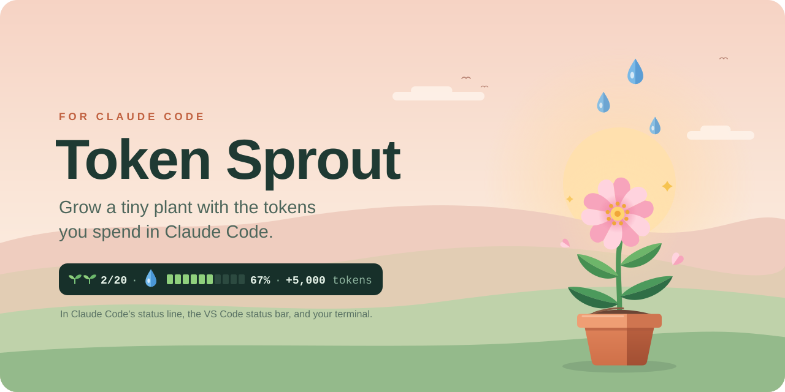
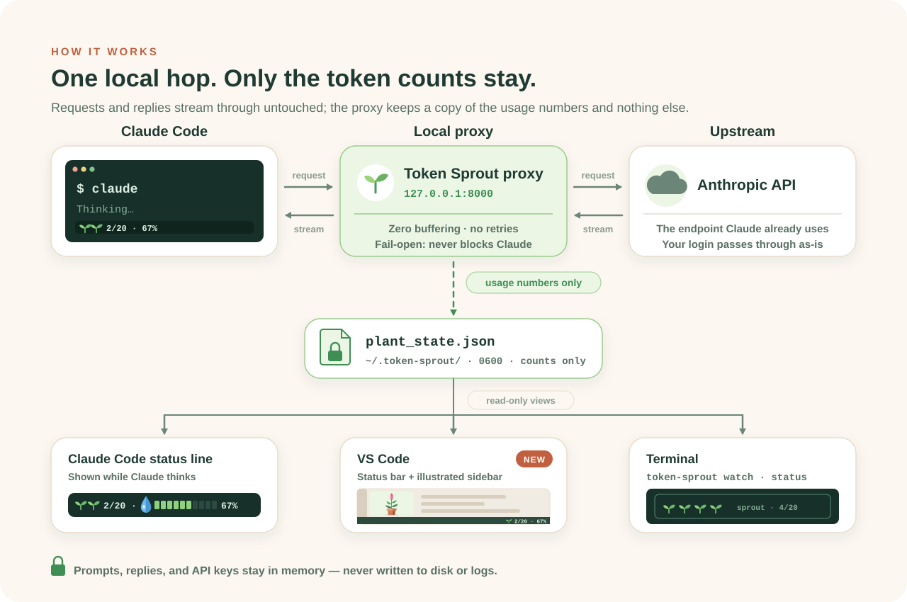
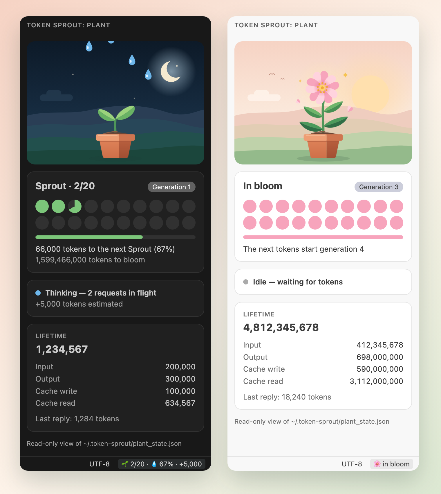
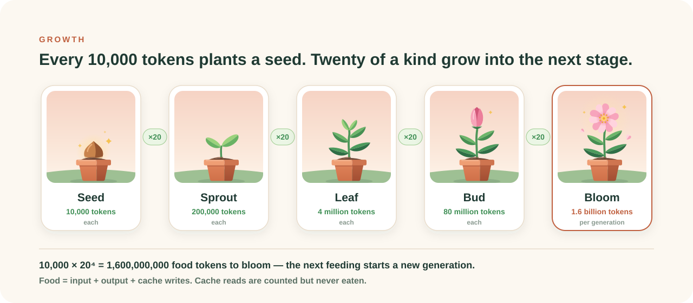

# Token Sprout 🌿

[English](README.md) | [繁體中文](README.zh-TW.md)

<picture>
  <source media="(prefers-color-scheme: dark)" srcset="docs/assets/hero-dark.svg">
  
</picture>

Grow a tiny plant with the tokens you spend in Claude Code.

Token Sprout is a local, transparent pass-through proxy. It observes token
usage metadata in Anthropic API responses and turns it into plant growth. Your
normal command stays `claude`; the plant appears in
[Claude Code's bottom status line](https://code.claude.com/docs/en/statusline)
while Claude is thinking — and, with the [VS Code extension](#vs-code-extension),
in the corner of the VS Code status bar and an illustrated sidebar.

<picture>
  <source media="(prefers-color-scheme: dark)" srcset="docs/assets/how-it-works-dark.svg">
  
</picture>

> **Status: `v0.2.1` released.** New in 0.2: a
> [VS Code extension](#vs-code-extension), redrawn artwork, and (0.2.1)
> conversations from Claude Code's own VS Code extension feeding the plant.
> Forwarding is unchanged since `v0.1.0`, whose release checks still apply: automated tests,
> package builds, a clean `pipx install .`, and macOS real-session checks —
> API-key and subscription-OAuth sessions, tool use, Esc cancellation, and a
> manual direct-vs-proxy streaming comparison. The extension is covered by
> unit tests and an automated run inside VS Code. `pipx` is the supported
> install path. Linux shell behavior is covered by CI; WSL2 remains
> experimental. Growth tuning, `uvx` validation, and a demo GIF are follow-ups.

## Install from GitHub

### Requirements

- macOS (manually verified), Linux (CI-covered), or experimental Windows
  10/11 support through WSL2
- zsh or bash (automatic shell integration does not support fish yet)
- Python 3.10 or newer: `python3 --version`
- Claude Code already installed: `claude --version`
- `pipx` is recommended so Token Sprout stays isolated from system Python

Native Windows PowerShell and Command Prompt are not supported. The WSL2 path
below is experimental: it is documented for early users but has not yet
completed an end-to-end check on a real Windows machine.

On macOS or Linux, install `pipx` first if needed. Windows users should skip
to the WSL2 section below instead:

```bash
# macOS with Homebrew
brew install pipx
pipx ensurepath

# Linux
python3 -m pip install --user pipx
python3 -m pipx ensurepath
```

Open a new terminal after `pipx ensurepath`.

### Windows 10/11 through WSL2 (experimental)

Install and launch Claude Code, Python, and Token Sprout inside the **same
WSL2 distribution**. Do not install Token Sprout in WSL and then launch the
native Windows `claude.exe`; that process will not use the WSL shell wrapper.

First open **PowerShell as Administrator** and install WSL2:

```powershell
wsl --install
```

Restart Windows, open PowerShell again, and confirm that Ubuntu is using
version 2:

```powershell
wsl --list --verbose
```

If Ubuntu shows version 1, convert it before continuing:

```powershell
wsl --set-version Ubuntu 2
```

Open the Ubuntu app and install the Linux prerequisites:

```bash
sudo apt update
sudo apt install -y python3 python3-venv pipx git curl
pipx ensurepath
```

Close Ubuntu, reopen it, and install Claude Code **inside WSL**:

```bash
curl -fsSL https://claude.ai/install.sh | bash
claude --version
```

Download and extract this repository. Windows files are visible inside WSL
under `/mnt/c`; for example, a ZIP extracted to the Windows Downloads folder
is usually reached with:

```bash
cd "/mnt/c/Users/YOUR_WINDOWS_USER/Downloads/token-sprout-main"
```

Use the actual extracted folder containing `pyproject.toml`, then continue
with steps 1 and 2 below. Run every Token Sprout and `claude` command inside
WSL. The private runtime directory will be the Linux path
`~/.token-sprout/`, where `0700`/`0600` permissions work normally.

For VS Code, install VS Code on Windows plus the
[WSL extension](https://code.visualstudio.com/docs/remote/wsl), then run
`code .` from the WSL project folder. New terminals in that VS Code window
will run inside WSL. See Microsoft's
[WSL installation guide](https://learn.microsoft.com/windows/wsl/install)
and Claude Code's
[Windows/WSL instructions](https://code.claude.com/docs/en/installation) for
the platform prerequisites.

### 1. Download and install

On GitHub, choose **Code → Download ZIP**, extract it, then open a terminal in
the extracted repository folder—the folder containing `pyproject.toml`.

```bash
cd /path/to/downloaded/token-sprout
pipx install .
token-sprout --version
```

If the Python chosen by `pipx` is older than 3.10, select a newer interpreter:

```bash
pipx install --python python3.13 .
```

### 2. Initialize and connect Claude Code

Run these once:

```bash
token-sprout init
token-sprout install-claude
token-sprout install-statusline
```

Then close that terminal, open a new one, and launch Claude normally:

```bash
claude
```

That is the complete setup. While Claude is using tokens, the bottom status
line looks like this:

```text
🌱🌱 2/20 · 💧 [██████░░░░] 67% · +5,000 tokens
```

The line hides when Claude is idle. Use
`token-sprout install-statusline --always` if you prefer a compact plant to
remain visible. Claude Code must trust the workspace before it runs a status
line command; interact once or restart Claude Code after installation.

## VS Code extension

See the plant in the corner of the VS Code status bar and in an illustrated
sidebar that follows your color theme: dawn in light themes, night in dark
ones.

<p align="center">
  
</p>

The extension needs the CLI from step 1 at version **0.2.1 or newer**, with
Claude Code launched through Token Sprout as in step 2. Download
`token-sprout-0.2.1.vsix` from the
[latest release](https://github.com/macacacacaca/token-sprout/releases/latest)
and install it:

```bash
code --install-extension token-sprout-0.2.1.vsix
```

Or open the Extensions view, choose **… → Install from VSIX…**, and pick the
file. The extension is not on the Visual Studio Marketplace yet.

- **Status bar:** `🌱 2/20` while idle, `🌱 2/20 · 💧 67% · +5,000` while
  Claude is thinking, and a short notice when the plant reaches a new stage.
  Hover for details; click to open the sidebar.
- **Sidebar:** the plant, watered while Claude thinks; a 20-cell tray that
  fills toward the next 20:1 merge; and lifetime token totals.
- **Settings:** `tokenSprout.statusBar.visibility` (`always`, `thinking`, or
  `hidden`), `tokenSprout.statusBar.showPile`, and
  `tokenSprout.executablePath` when `token-sprout` is not on `PATH` or in
  `~/.local/bin`.

The extension only reads. It runs `token-sprout watch --json`, a read-only
stream of the same numbers the other views show, and displays it in English
or Traditional Chinese to match VS Code. With Remote - SSH, WSL, or Dev
Containers it runs where the workspace runs, so install the CLI there too.

### Using Claude Code's VS Code extension?

Conversations in the Claude Code panel start their own `claude`, so the shell
integration from step 2 never sees them and the plant does not grow. Connect
them once: run **Token Sprout: Connect Claude Code** from the Command Palette
(Token Sprout also offers it). After you confirm, it sets Claude Code's
`claudeCode.claudeProcessWrapper` setting to `token-sprout-claude`, which
routes new conversations through the shared local proxy. Conversations that
are already open keep running unchanged until they restart.

- If the proxy cannot be verified or started — or you already use your own
  `ANTHROPIC_BASE_URL`, Bedrock, Vertex, or Foundry — `token-sprout-claude`
  starts Claude unchanged, without the plant.
- While a process wrapper is set, Claude Code starts new conversations in the
  permission mode you last picked in its panel (Manual if you never picked
  one).
- **Token Sprout: Disconnect Claude Code** removes the setting.

## What the installers change

`install-claude` adds one marked, removable shell function:

- zsh: `$ZDOTDIR/.zshrc` when `ZDOTDIR` is set, otherwise `~/.zshrc`
- bash on macOS: `~/.bash_profile`
- bash on Linux: `~/.bashrc`

The function stores the absolute paths of `token-sprout` and the existing
Claude executable. It does not replace Claude or save an API URL or
credential. If an alias or function named `claude` already exists—including
one loaded from another sourced file—Token Sprout leaves it unchanged and
prints a warning. Review the conflict before using `--force`.

`install-statusline` merges this project's command into
`~/.claude/settings.json`, preserves all other settings, and self-tests the
command before writing. It refuses to replace a status line it does not own
unless you explicitly pass `--force`.

## Daily use

Just use Claude Code normally:

```bash
claude
claude --resume
```

The managed function calls `token-sprout run -- <absolute Claude path>`. For
that child process only, `run` sets the local API base URL and enables Claude
Code's dynamic tool search when you have not chosen an explicit
`ENABLE_TOOL_SEARCH` value. It starts the shared localhost proxy in the
background if needed and leaves it running, because other terminals and VS
Code conversations may be using it; `token-sprout stop` ends it. `run` never
prints the command arguments, which may contain a private prompt, and writes
its status lines to stderr.

Useful commands:

```bash
token-sprout status       # one-shot plant and token summary
token-sprout watch        # animated panel in another terminal
token-sprout watch --json # read-only JSON lines (the VS Code extension uses this)
token-sprout stop         # stop the shared background proxy
token-sprout reset        # start again after confirmation
```

The animated panel needs a terminal at least 44×12:

```text
╭──── Token Sprout 🌿  generation 1 ────╮
│      💧            💧                 │
│           💧                          │
│ 🌱 🌱 🌱 🌱                           │
│ sprout  ·  4/20                       │
│ Thinking... (1 request in flight)     │
╰───────────── Ctrl+C to exit ─────────╯
```

### Optional `/plant` skill

Tracking must begin when Claude launches; `/plant` is only a convenient
read-only [Claude Code skill](https://code.claude.com/docs/en/slash-commands).
Create `~/.claude/skills/plant/SKILL.md` with:

```markdown
---
name: plant
description: Show my Token Sprout plant status
allowed-tools: Bash(token-sprout status)
---

## Current plant

!`token-sprout status`

Summarize the plant status above in one friendly sentence.
```

Restart Claude Code, then enter `/plant`.

### Explicit or manual launch

The shell installer is optional. You can always run:

```bash
token-sprout run -- claude
token-sprout run --port 8100 -- claude --resume
```

For debugging with two terminals:

```bash
# terminal 1
token-sprout proxy --port 8000

# terminal 2 (this terminal only)
ANTHROPIC_BASE_URL=http://127.0.0.1:8000 ENABLE_TOOL_SEARCH=true claude
```

Do not save `ANTHROPIC_BASE_URL` in your shell configuration. Claude will be
unable to connect whenever the proxy is not running.

## Growth rules

Only successful `POST /v1/messages` usage feeds the plant:

| Usage field | Tracked | Feeds growth |
|---|---:|---:|
| `input_tokens` | ✅ | ✅ |
| `output_tokens` | ✅ | ✅ |
| `cache_creation_input_tokens` | ✅ | ✅ |
| `cache_read_input_tokens` | ✅ | ❌ |

Cache reads are displayed but excluded from food because Claude Code can read
millions of cached tokens in a day. These numbers are a game mechanic, not a
billing ledger. `/v1/messages/count_tokens` is also excluded because it is an
estimate, not real consumption.

<picture>
  <source media="(prefers-color-scheme: dark)" srcset="docs/assets/growth-dark.svg">
  
</picture>

Every **10,000 food tokens** creates one seed. Twenty units of the current
stage merge into one unit of the next stage:

```text
🌰×20 → 🌱×1  ·  🌱×20 → 🪴×1  ·  🪴×20 → 🌷×1  ·  🌷×20 → 🌸
```

Growth is cumulative across the entire generation: `current_exp` does not
reset when units merge. One seed costs 10,000 food tokens; one sprout costs
200,000; one leaf plant costs 4,000,000; and one bud costs 80,000,000. Bloom
takes **1,600,000,000 food tokens** (`10,000 × 20⁴`). Bloom remains on
screen; the next feeding starts a new generation and resets only that
generation's progress. Lifetime token totals remain. The live
status bar estimates progress toward the next unit of the current stage (~4
characters per token); the plant commits only exact usage received when a
response finishes.

## Security model

With the documented default upstream, requests go only to the same Anthropic
API endpoint Claude Code already uses.

- The proxy binds only to `127.0.0.1`.
- Request and response bodies pass through memory and are never stored or
  logged.
- `x-api-key` and `authorization` headers are forwarded unchanged and are
  never parsed, logged, or persisted.
- Forwarding uses raw bytes, preserves duplicate response headers, does not
  retry upstream errors, and does not wait for plant-state disk writes.
- Before using a listener, `run` and `token-sprout-claude` verify a fresh,
  port-bound HMAC proof; `token-sprout stop` signals only a proxy that passes
  the same check.
- `token-sprout-claude`, the editor wrapper, never reads, logs, or stores
  credentials or arguments and writes only to stderr. When it cannot verify
  or start the proxy, it starts Claude unchanged.
- Request paths in logs have control characters escaped and are length-limited.

Token Sprout keeps this private directory at mode `0700`; all files below are
mode `0600`, including after upgrading an older installation:

| Path under `~/.token-sprout/` | Contents |
|---|---|
| `plant_state.json` | Usage counters, plant state, and timestamps |
| `plant_state.json.corrupt` | Quarantined copy of a damaged state file, kept for manual recovery (only if damage ever occurs) |
| `proxy.log` | Method, sanitized path, status, and duration; no bodies or headers |
| `proxy.secret` | Random secret for local proxy identity checks |
| `state.lock` | State update lock |

Optional writes outside that directory happen only when you run an installer:

- the marked shell block described above;
- the `statusLine` object in `~/.claude/settings.json`.

The VS Code extension makes no network requests and writes no files of its
own; installing it only adds VS Code's copy of the extension. It changes VS
Code settings only when you choose **Connect Claude Code**, **Disconnect
Claude Code**, or **Don't ask again**.

- It starts exactly one program, `token-sprout watch --json`, without a
  shell. The executable comes from absolute `PATH` entries, `~/.local/bin`,
  or the machine-scoped `tokenSprout.executablePath`, which workspace
  settings cannot override.
- `watch --json` never takes the state lock, never writes, and never creates
  `~/.token-sprout/`; its lines carry token counts only.
- Each line is validated before display. The sidebar webview runs under a
  strict Content Security Policy and loads only files bundled with the
  extension.

A malicious process running under your own OS account is outside this threat
boundary because it can already read that account's Claude credentials. See
[SECURITY.md](SECURITY.md) to report a vulnerability privately.

## Known limitations

- Token Sprout is validated for Claude Code; other Anthropic clients may work
  but are not claimed as supported.
- The VS Code extension ships as a `.vsix` on GitHub Releases, not yet on the
  Visual Studio Marketplace or Open VSX. Its integration test passes in VS
  Code 1.142 on macOS; it declares support for VS Code 1.90 or newer.
- Automatic shell setup supports zsh and bash on macOS and is exercised on
  Linux in CI. Native Windows PowerShell/CMD and fish are not supported;
  Windows through WSL2 remains an experimental, not yet end-to-end verified
  path.
- Per Claude Code's
  [environment-variable behavior](https://code.claude.com/docs/en/env-vars),
  **Remote Control is unavailable** while a non-first-party base URL such as
  the localhost proxy is active. Dynamic tool search remains enabled unless
  you explicitly set `ENABLE_TOOL_SEARCH` yourself.
- Forwarding is designed and tested not to buffer responses. A manual macOS
  direct-vs-proxy session showed no repeatable visible delay or batching, and
  Esc cancellation completed normally. No release yet includes a published
  instrumented latency benchmark.

## Troubleshooting

**`token-sprout: command not found`**

Run `pipx ensurepath`, open a new terminal, and try again. Confirm with
`pipx list`. If necessary, reinstall with
`pipx install --python python3.13 .` from the downloaded folder.

**An existing `claude` alias/function was left unchanged**

Run `type claude` in a new shell and inspect your shell startup files,
including files sourced by `.zshrc` or `.bashrc`. Remove or rename the
conflicting override, then rerun `token-sprout install-claude`. Use `--force`
only when you intentionally want Token Sprout to replace it at shell runtime.

**Port 8000 is already in use**

Token Sprout refuses to pass credentials to an unverified listener. Stop the
other service or launch explicitly with
`token-sprout run --port 8100 -- claude`.

**The status line does not appear**

Make sure the workspace is trusted, interact once or restart Claude Code, then
run `token-sprout install-statusline` again. If the installation moved, this
command discovers and writes its new absolute executable path.

**The plant does not grow while I use Claude Code in VS Code**

Run **Token Sprout: Connect Claude Code**, then start a new conversation in the
Claude Code panel. New requests should appear in
`~/.token-sprout/proxy.log` within seconds.

**Claude cannot reach the API**

Do not export `ANTHROPIC_BASE_URL` globally. Start a fresh terminal and launch
through plain `claude` after installing the integration. Check
`~/.token-sprout/proxy.log`; it never contains prompts or credentials.

## Uninstall

Remove integrations before removing the executable. If you connected Claude
Code in VS Code, first run **Token Sprout: Disconnect Claude Code**; otherwise
Claude Code would keep trying to start through the removed
`token-sprout-claude`.

```bash
code --uninstall-extension macacacacaca.token-sprout   # if you installed it
token-sprout stop
token-sprout uninstall-statusline
token-sprout uninstall-claude
pipx uninstall token-sprout
```

These commands preserve Claude Code and every unrelated setting. If you also
want to erase your plant history, manually delete `~/.token-sprout/`. Delete
`~/.claude/skills/plant/` separately if you created the optional skill.

## Development

Use Python 3.10 or newer; the repository's development environment uses 3.13:

```bash
python3.13 -m venv .venv
.venv/bin/pip install -e ".[dev]"
.venv/bin/pytest -W error
```

The VS Code extension needs Node.js 22 or newer:

```bash
cd vscode-extension
npm ci --ignore-scripts
npm run check && npm test       # type check and unit tests
npm run test:integration        # the real CLI inside an isolated VS Code
npx vsce package --no-dependencies
```

`test:integration` defaults to the macOS VS Code in `/Applications` and the
repository's `.venv`; set `VSCODE_BIN` and `TOKEN_SPROUT_CLI` to override.

Every illustration is generated by one standard-library script, so the README,
the extension, and the social preview stay consistent:

```bash
python scripts/build_art.py           # rewrite the SVGs
python scripts/build_art.py --check   # fail when a committed SVG is stale
python scripts/build_art.py --png     # also rasterize PNGs with headless Chrome
```

The art direction borrows principles, not pixels: flat two-tone facets after
*Monument Valley* (Apple Design Award 2014) and layered, atmospheric
landscapes after *Alto's Odyssey* (Apple Design Award 2018). Every shape is
original.

CI tests Python 3.10–3.13, treats warnings as errors, compiles the source,
checks installed dependencies, audits them, builds a wheel, smoke-tests a
clean wheel installation, checks that the generated art is current, and type
checks, tests, audits, and packages the extension.

| File | Responsibility |
|---|---|
| `token_sprout/proxy.py` | Transparent raw-byte forwarding and fail-open usage tee |
| `token_sprout/usage_parser.py` | JSON and incremental SSE usage extraction |
| `token_sprout/state.py` | Private files, single-writer state, lock, atomic replace |
| `token_sprout/game.py` | Token-to-growth rules |
| `token_sprout/ui.py`, `ascii_art.py` | Read-only status and animation views |
| `token_sprout/feed.py` | Read-only JSON line feed for editors (`watch --json`) |
| `token_sprout/cli.py` | CLI, lifecycle, shell integration, and statusline installer |
| `vscode-extension/` | VS Code status bar item and illustrated sidebar |
| `scripts/build_art.py` | Generates every illustration |

The repository's [`docs/technical-spec.md`](docs/technical-spec.md) is the
authoritative technical specification (v0.1, with the v0.2 additions in §15)
and takes precedence over implementation decisions.

## License

MIT
